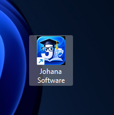
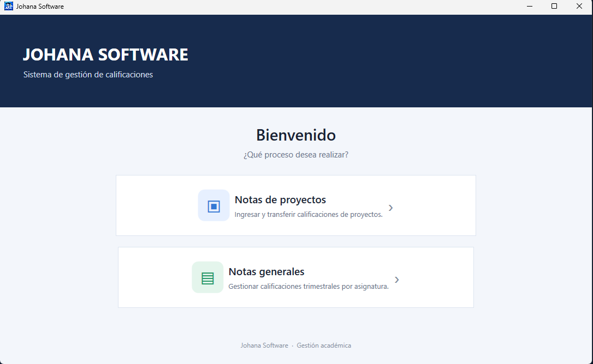
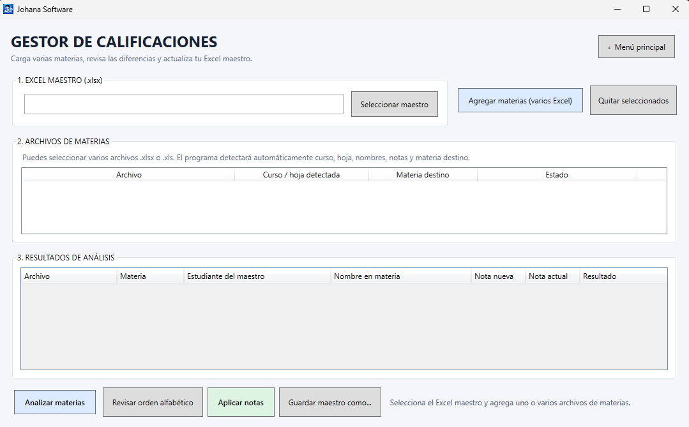
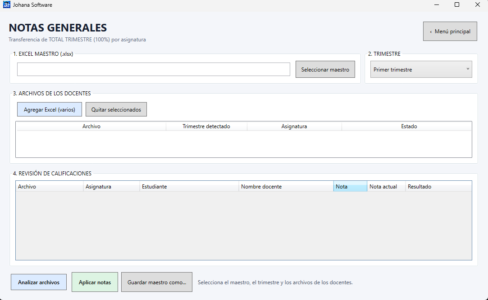
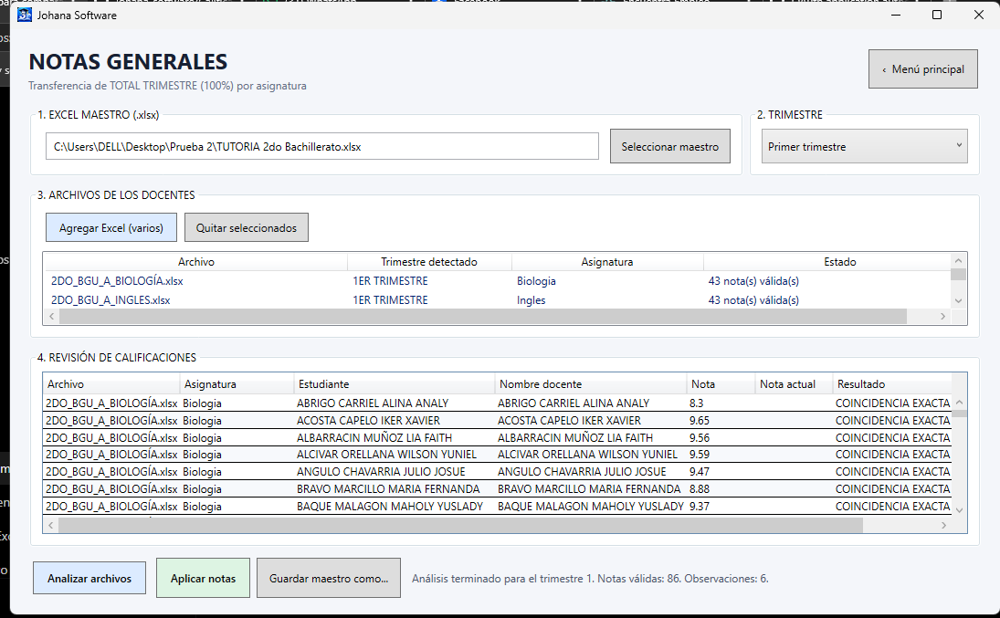

# 🎓 Johana Software

 

  <strong>Sistema de gestión y transferencia de calificaciones académicas</strong> 
  Una herramienta de escritorio para organizar el trabajo con archivos Excel y facilitar la actualización de calificaciones.

  
  
  
  

---

## ✨ ¿Qué es Johana Software?

**Johana Software** es una aplicación de escritorio desarrollada para apoyar la gestión de calificaciones académicas mediante archivos de Microsoft Excel. Reúne dos procesos en una interfaz sencilla: la gestión de notas de proyectos y la transferencia de notas generales por asignatura y trimestre.

## 🖥️ Vista general

  

Desde el menú principal puedes ingresar al módulo que necesitas:

- **Notas de proyectos:** carga de varias materias, revisión de diferencias y actualización del Excel maestro.
- **Notas generales:** transferencia de calificaciones trimestrales por asignatura.

## 📚 Módulos principales

### 1. Notas de proyectos

Permite seleccionar un Excel maestro y agregar varios archivos de materias. La pantalla reúne los archivos cargados y los resultados del análisis para revisar la información antes de aplicar las notas.

### 2. Notas generales

  

Permite seleccionar el Excel maestro, elegir el trimestre y agregar uno o varios archivos de los docentes. El módulo está orientado a transferir el **TOTAL TRIMESTRE (100%)** por asignatura.

### 🔎 Revisión de calificaciones

  

Antes de aplicar los cambios, puedes analizar los archivos y revisar las coincidencias, las notas detectadas y los resultados del proceso.

## 🚀 Características

- Interfaz de escritorio con menú principal y dos módulos.
- Carga de uno o varios archivos Excel, según el módulo.
- Selección del archivo Excel maestro.
- Selección de trimestre en el módulo de notas generales.
- Análisis y revisión de calificaciones antes de aplicarlas.
- Actualización del archivo maestro mediante automatización de Microsoft Excel, para conservar su estructura y formato.

## 🧰 Tecnologías

- **C#**
- **.NET 8**
- **WPF (Windows Presentation Foundation)**
- **Microsoft Excel Interop / automatización de Excel**
- **Inno Setup** para generar el instalador de Windows.

## 💻 Requisitos

- Windows 10 o Windows 11 de 64 bits.
- Microsoft Excel de escritorio instalado.
- Para ejecutar la versión publicada autocontenida, no es necesario instalar .NET por separado.

> **Importante:** la aplicación utiliza Microsoft Excel de escritorio. Excel Online o aplicaciones alternativas como LibreOffice no sustituyen este requisito.

## 📦 Instalación

1. Descarga el instalador de Johana Software desde la sección **Releases** del repositorio, si hay una versión publicada.
2. Ejecuta `Johana_Software_Setup.exe`.
3. Sigue los pasos del asistente de instalación.
4. Abre Johana Software desde el acceso directo del escritorio.

Si todavía no existe una versión en **Releases**, solicita el instalador al responsable del proyecto.

## 🛠️ Ejecutar desde el código fuente

Requisitos para desarrollo:

- Visual Studio 2022.
- SDK de .NET 8.
- Microsoft Excel de escritorio.

Pasos generales:

1. Clona este repositorio.
2. Abre el archivo `.csproj` en Visual Studio.
3. Restaura los paquetes NuGet.
4. Compila y ejecuta el proyecto.

## 🔐 Uso responsable de la información

Los archivos Excel pueden contener información académica personal. Por seguridad:

- No publiques archivos reales de estudiantes en este repositorio.
- No incluyas calificaciones, nombres, cédulas ni datos institucionales en capturas o ejemplos públicos.
- Trabaja con copias de los archivos originales y conserva un respaldo del Excel maestro antes de realizar cambios.

## 📌 Estado del proyecto

Proyecto de escritorio para Windows. Las funciones disponibles corresponden a los módulos incluidos en el código fuente de este repositorio.

---

  Hecho para facilitar la gestión académica. 
  <strong>Johana Software</strong>

